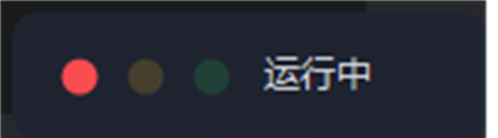
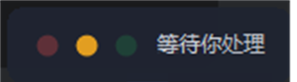
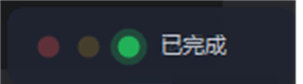

# 任务完成红绿灯 · Completion traffic light

一个 DSH 插件：用红黄绿灯告诉你当前任务处于什么状态。灯有两处显示：

- **客户端窗口内**：输入框下方状态带里的一枚小灯（所有平台）
- **客户端窗口外**：桌面右下角的置顶小窗（仅 Windows 桌面端）

| 运行中 | 等待你处理 | 已完成 |
| --- | --- | --- |
|  |  |  |

## 灯的含义

| 灯 | 状态 | 含义 |
| --- | --- | --- |
| 🔴 红 | 运行中 | 至少有一个会话正在跑 turn（子代理也算） |
| 🟡 黄 | 等待你处理 | 有审批或提问在等你 |
| 🟢 绿 | 已完成 | 所有 turn 结束；刚结束时绿灯会额外亮 8 秒 |
| ⚪ 灰 | 待命 | 本次启动还没有跑过任务 |

## 安装

```sh
dsh plugin add dsh-completion-traffic-light
```

装完重启 DeepSeek Harness 即可看到输入框下方的灯；Windows 桌面端还会在右下角出现置顶小窗。

也可以从 GitHub 安装：

```sh
dsh plugin add github:LuckYur/completion-traffic-light
```

## 窗外小窗（Windows 桌面端）

- 默认贴在屏幕**右下角**，始终置顶
- **空闲自动贴边收起**：没有任务在跑时，窗口收成一条 14px 宽的小指示条贴在右边（只显示一个状态点）；鼠标移上去展开，移开且仍空闲 2.5 秒后再收起来；任务一开始跑就自动展开
- **拖动**：按住左键拖动
- **透明度**：脚本顶部的 `$windowOpacity`（`1.0` 完全不透明，`0.85` 略透出背景，越小越透）
- **双击 / 右键「回到 DeepSeek Harness」**：把主窗口叫回前台
- **右键「关闭红绿灯」**：关掉小窗；异常退出时 Host 会在 3 秒后自动拉起（最多 5 次）
- 宿主进程退出时小窗会自行关闭，不会留下孤儿窗口

## 配置

在 profile 的 patch 层把该行的 config 设为 `window: false` 可关闭窗外小窗，只保留窗口内的灯：

```yaml
- id: completion-traffic-light
  name: 'dsh-completion-traffic-light'
  config:
    window: false
```

## 结构

| 文件 | 作用 |
| --- | --- |
| `index.js` | Host 半：监听 `api-session/status`，把聚合状态写进状态文件，并拉起/回收小窗进程 |
| `float-window.ps1` | 小窗本体：PowerShell + WinForms，轮询状态文件绘制三灯 |
| `client.js` | Client 半：注册到 `conversation.composer.dock`，用 `useSessionStatus` 画窗口内的灯 |
| `cordis.patch.yml` | bundle 的插入行 |
| `locale/*.json` | 插件管理里的标题/描述与灯的中英文文案 |

小窗通过临时目录里的 `state.txt` 和 Host 通信（`running` / `waiting` / `done:<epoch-ms>` / `idle`），Host 退出时小窗检测不到父进程会自行退出。

> 改 `float-window.ps1` 时必须保存为 **UTF-8 with BOM**：Windows PowerShell 5.1 会把无 BOM 的 UTF-8 当 GBK 解码，中文乱码后整个脚本解析失败、窗口起不来。

## 已知限制

- 窗外小窗只在 **Windows 桌面端**启动；web 版只有窗口内的灯。
- 小窗位置不记忆，重启回到右下角。
